<picture>
  <source media="(prefers-color-scheme: dark)" srcset="assets/header-dark.svg">
  
</picture>

10+ years in IT, now building applications end to end and running the infrastructure under them.

I work across the whole stack: the interface people use, the backend logic behind it, and the servers, containers and networks it runs on. I started in hands-on support and repair, moved into network operations and platform work, and now build and run applications end to end, with AI integration part of most of what I build day to day.

[lorenztazan.com](https://lorenztazan.com) &nbsp;·&nbsp; [contact@lorenztazan.com](mailto:contact@lorenztazan.com)

 

<h2><picture><source media="(prefers-color-scheme: dark)" srcset="assets/label-what-i-do-dark.png"></picture></h2>

**I keep systems running and build what runs on them.**

**infrastructure & networks** 
I run Linux servers and the networks underneath them: MikroTik and pfSense on a telecom network serving 700+ concurrent subscribers, workstation and network rollouts for small offices, and the documentation that lets someone else take over. 10+ years hands-on, from the repair bench to the server rack.

**platform & servers** 
I run a high-availability network of 25+ containerized server nodes on Debian bare metal with Docker, load balancing and automated failover, and build the server modules that keep data in sync across them.

**web development** 
I build websites for small businesses and creatives, from planning to launch, with accessibility and security built in from the start.

<h2><picture><source media="(prefers-color-scheme: dark)" srcset="assets/label-currently-dark.png"></picture></h2>

- Systems & infrastructure engineering for a multiplayer game network (contract)
- Redesigning my portfolio, [lorenztazan.com](https://lorenztazan.com)

<h2><picture><source media="(prefers-color-scheme: dark)" srcset="assets/label-stack-dark.png"></picture></h2>

Tools I use today or have used in past roles and projects.

**languages** 
`C#` `C++` `JavaScript` `TypeScript` `Python` `Java` `PHP`

**frontend frameworks** 
`React` `Next.js` `Vue.js` `Astro`

**frontend libraries & tooling** 
`GSAP` `Three.js` `Tailwind CSS` `SCSS` `Styled Components` `Vite` `Webpack` `ESLint` `Prettier`

**backend frameworks** 
`Node.js` `Express.js` `NestJS` `FastAPI` `Spring Boot` `Laravel`

**apis** 
`REST` `GraphQL` `gRPC`

**data** 
`PostgreSQL` `MySQL` `MariaDB` `MongoDB` `Redis` `DynamoDB`

**operating systems & shell** 
`Linux OS` `macOS` `Windows` `Bash` `systemd`

**networking** 
`MikroTik` `pfSense` `OPNsense` `TP-Link` `Ubiquiti` `IoT`

**cloud** 
`Cloudflare` `Cloudflare Workers` `AWS` `AWS Lambda` `GCP` `Azure`

**devops & hosting** 
`Docker` `Kubernetes` `Pterodactyl` `NGINX` `Terraform` `AWS CloudFormation` `GitHub Actions` `GitLab CI` `Jenkins` `Prometheus` `Grafana` `Datadog`

**security & identity** 
`OAuth` `JWT` `LDAP` `AWS IAM` `Azure AD` `Okta` `Auth0` `Cognito` `SAP CDC` `AES` `RSA` `SHA` `GDPR` `SOC 2` `ISO 27001`

**ai models & platforms** 
`Anthropic` `ChatGPT` `Gemini` `Mistral` `Hugging Face` `PyTorch` `TensorFlow` `LangChain` `LM Studio`

**ai coding & agents** 
`Claude Code` `Codex` `Gemini CLI` `OpenCode` `Antigravity` `Hermes Agent` `n8n`

**mobile apps** 
`Xcode` `Android Studio` `Apple Developer`

**game dev, 3d & design** 
`Godot` `Blender` `Blockbench` `Figma` `DaVinci Resolve`

**cms & site builders** 
`WordPress` `Strapi` `Webflow` `Wix` `Squarespace` `SharePoint`

**developer tools** 
`Git` `GitHub` `GitLab` `Bitbucket` `VS Code` `IntelliJ IDEA` `PyCharm`

**collaboration** 
`Microsoft 365` `Jira` `Trello` `ClickUp` `Slack` `Microsoft Teams` `Discord`

<h2><picture><source media="(prefers-color-scheme: dark)" srcset="assets/label-projects-dark.png"></picture></h2>

**side projects**

**[This portfolio](https://github.com/AIKUSAN/portfolio)** &nbsp;·&nbsp; 2026 · live at [lorenztazan.com](https://lorenztazan.com) 
Astro on a Cloudflare Worker: role-tailored pages, a Turnstile-protected contact form and an interactive 3D rack. 
`Astro` `TypeScript` `Cloudflare Workers` `Three.js`

**lab projects** · independent builds, not client work

**[AI Agentic Network Automation](https://github.com/AIKUSAN/ai-agentic-network-automation)** &nbsp;·&nbsp; 2026 · ai & automation 
Multi-agent LLM system for network operations: one model designs, one writes config, one deploys, with retrieval over past runs. 
`Python` `LangChain` `Gemini` `Claude` `GPT-4` `ChromaDB`

**[NetOps Automation Framework](https://github.com/AIKUSAN/netops-automation-framework)** &nbsp;·&nbsp; 2026 · ai & automation 
Configuration drift detection, risk assessment and automated remediation, with two models cross-checking each change. 
`Python` `Docker` `Gemini` `Claude`

**[Regional Fiber ISP: Core Network](https://github.com/AIKUSAN/regional-fiber-isp)** &nbsp;·&nbsp; 2026 · networks 
Core network design for a regional fiber ISP, with MikroTik routing and CGNAT. 
`MikroTik` `RouterOS` `CGNAT`

**[Global Traffic Manager](https://github.com/AIKUSAN/global-traffic-manager)** &nbsp;·&nbsp; 2026 · networks 
DNS-based global load balancing: geographic steering through custom F5 GTM iRules, health monitoring, and AI-written failover and incident reports. 
`Python` `Lua` `F5 BIG-IP` `Gemini` `Claude`

**[Container Orchestration & Infrastructure](https://github.com/AIKUSAN/docker-kubernetes-automation)** &nbsp;·&nbsp; 2026 · devops 
Kubernetes deployments with GitOps, monitoring and infrastructure as code for repeatable environments. 
`Docker` `Kubernetes` `Bash`

**[Bash DevOps Toolkit](https://github.com/AIKUSAN/bash-devops-toolkit)** &nbsp;·&nbsp; 2026 · devops 
Scripts for day-to-day server administration and multi-environment deployments. 
`Bash` `Linux`

**[MariaDB Performance Optimization](https://github.com/AIKUSAN/mariadb-optimization-guide)** &nbsp;·&nbsp; 2026 · data 
A clustering, replication and query-tuning guide built from the database work in my contract role, where application latency went from 80 ms to 35 ms across 2M+ queries a day. 
`MariaDB` `MySQL` `Bash`

<h2><picture><source media="(prefers-color-scheme: dark)" srcset="assets/label-activity-dark.png"></picture></h2>

<picture>
  <source media="(prefers-color-scheme: dark)" srcset="https://raw.githubusercontent.com/AIKUSAN/AIKUSAN/output/pet-dark.svg">
  
</picture>

